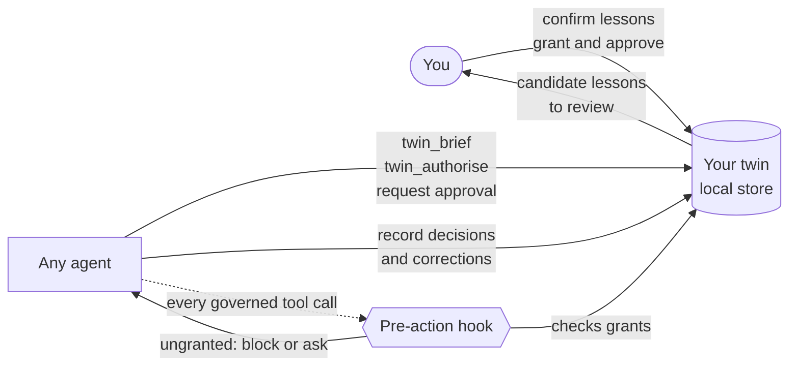

<!-- mcp-name: io.github.GitDakky/twin-me-up -->
<p align="center">
  
</p>

<p align="center">
  <a href="https://pypi.org/project/twin-me-up/"></a>
  <a href="https://pypi.org/project/twin-me-up/"></a>
  <a href="https://github.com/GitDakky/twin-me-up/actions/workflows/ci.yml"></a>
  <a href="https://scorecard.dev/viewer/?uri=github.com/GitDakky/twin-me-up"></a>
  <a href="https://github.com/GitDakky/twin-me-up/blob/main/LICENSE"></a>
  
</p>

<p align="center">
  <b>Teach it once. Every agent you use works the way you would, and asks before it acts.</b>
</p>

<p align="center">
  <a href="#quick-start">Quick start</a> ·
  <a href="#install-with-one-prompt">One-prompt install</a> ·
  <a href="#how-it-works">How it works</a> ·
  <a href="#works-with">Works with</a> ·
  <a href="#the-research">The research</a> ·
  <a href="#safety-model">Safety</a>
</p>

<p align="center">
  
</p>

## Why

You probably use more than one AI agent. Each one starts from zero. It does not know what you
care about, which corners you never cut, or which decisions you always want to make yourself.
So you repeat yourself, correct the same mistakes, and hope nothing consequential happens
before you look.

Twin Me Up is a small, local, open-source service that gives every agent the same answers to
three questions:

1. **How does this person want this kind of work done?** Your confirmed guidance, criteria,
   exceptions and red lines, briefed to the agent at the start of work.
2. **Am I allowed to do this?** Explicit grants, scoped to a workflow and a set of actions, with
   optional expiry. Anything not granted returns `ask`. Optional hooks enforce that outside the
   model.
3. **What did I just learn?** Your decisions and corrections become candidate lessons. Only you
   can confirm them.

It is not a chatbot of you, a personality clone or an autonomous replacement for you. The
evidence does not support those claims, and [the research](https://github.com/GitDakky/twin-me-up/blob/main/docs/research.md) explains why.

## What makes it different

| | |
|---|---|
| **Learning you ratify** | Agents propose lessons. Only you confirm, revise, reject or retire them. Every lesson keeps its origin, sources and history. |
| **Authority you grant** | Agents act on explicit grants for a workflow and named actions, optionally expiring. Actions in the reserved `twin.` namespace can never be granted to anyone. |
| **Enforcement outside the model** | Pre-action hooks for Hermes, Claude Code and pi block or escalate ungranted tool calls. They fail closed. |
| **Evidence, not vibes** | Freeze held-out decisions, then test the twin against a generic assistant and a rules-only baseline. Results come with sample-size warnings. |
| **One twin, every agent** | One MCP server, a native pi extension, a CLI bridge and function-calling schemas. Thirteen agent systems and frameworks documented, ten verified live. |
| **Yours** | Local SQLite with owner-only files, a tamper-evident audit log, portable export, and erasure that removes everything derived from a record. No telemetry. |

### Compared with what you might use today

| | A rules file or system prompt | Built-in agent memory | Twin Me Up |
|---|---|---|---|
| Works across every agent you use | Copied into each one | Within one product | One twin, over MCP |
| Learns from your corrections | No | Often, automatically | Yes, as proposals |
| You approve what it learns | You write all of it | Usually after the fact | Always, before it counts |
| Stops actions you have not allowed | No | No | Yes: grants, `ask` and hooks |
| Shows whether it actually helps | No | No | Held-out tests against baselines |
| Where your data lives | Your files | The vendor | Your machine |

## Quick start

You need Python 3.11 or later and [uv](https://docs.astral.sh/uv/) (or pipx). macOS and Linux
are tested. Windows should work but is untested.

```bash
uv tool install twin-me-up        # or: pipx install twin-me-up
twinmeup init                     # your name and a passphrase, in your own terminal
twinmeup connect --list           # every supported agent system
twinmeup connect claude-code      # the exact steps for one of them, with your paths
twinmeup doctor                   # check everything, including a live MCP handshake
```

`twinmeup init` asks for your name and a passphrase. The passphrase guards everything only you
should do: confirming lessons, granting authority, exporting and erasing. Agents are never
given it, and those commands refuse to run without it.

Only need the MCP server? After `twinmeup init`, any MCP client can start it with
`uvx twin-me-up`. Prefer the latest code? `uv tool install git+https://github.com/GitDakky/twin-me-up`.

Upgrading? Run `uv tool upgrade twin-me-up` (or `pipx upgrade twin-me-up`), then `twinmeup doctor`.
The [FAQ](#faq) explains what an upgrade changes for your twin.

Using Claude Desktop? After `twinmeup init`, download the `.mcpb` desktop extension from the
[latest release](https://github.com/GitDakky/twin-me-up/releases/latest) and open it. One bundle
works on macOS, Windows and Linux.

## Install with one prompt

Already working inside an agent? Paste this into it.

<details open>
<summary><b>Copy-paste install prompt</b></summary>

```text
Install Twin Me Up for me and connect it to yourself. Twin Me Up is a local, open-source
work twin: it learns how I make decisions, briefs you at the start of work and tells you when
you need my approval. Repository: https://github.com/GitDakky/twin-me-up

Work step by step and show me each command you run.

1. Install it. Prefer uv:
     uv tool install twin-me-up
   If uv is not available, use pipx:
     pipx install twin-me-up
   If PyPI cannot be reached, install from GitHub instead:
     uv tool install git+https://github.com/GitDakky/twin-me-up
   Then check with: twinmeup version

2. Ask me to run `twinmeup init` myself, in my own terminal, and wait until I say it is done.
   It sets my name and a passphrase that only I know. Do not run it for me, do not ask me for
   the passphrase, and never type a passphrase anywhere.

3. Run `twinmeup connect --list`, pick the entry that matches you (or `generic`), then run
   `twinmeup connect <entry>` and carry out the steps it prints to register the MCP server and
   install the skill. If it offers optional enforcement hooks, show me the action map and the
   hook configuration first, and install them only if I agree.

4. Run `twinmeup doctor` and report the result.

5. If your system needs a new session to load MCP tools, tell me. Otherwise call twin_brief
   for workflow "general" and summarise what it says.

While you work with my twin:
- Call twin_brief at the start of a piece of work.
- Call twin_authorise before anything consequential: sending, paying, publishing, deleting or
  committing on my behalf. If the answer is "ask", prepare a draft, request my approval with
  twin_request_approval, and act only once twin_approval_status says it is approved.
- Give every write a request_id, so a retry never records anything twice.
- When I correct you, record it with twin_record_correction.
- Never try to confirm lessons, approve requests, grant authority, export or erase. Those are
  mine, and the twin will refuse you anyway.
```

</details>

The agent installs the package, connects itself and checks the result. The two steps that
matter stay with you: choosing the passphrase, and approving any enforcement hooks. The prompt
is also in [docs/install-prompt.md](https://github.com/GitDakky/twin-me-up/blob/main/docs/install-prompt.md).

## How it works



### The loop

1. **Orient.** At the start of work the agent calls `twin_brief`. It gets your confirmed
   guidance for the workflow, with boundaries and escalation rules always included, and a list
   of what it is authorised to do.
2. **Check.** Before anything consequential it calls `twin_authorise`. The answer is `allow`
   only when a live grant covers the action. Otherwise it is `ask`: the agent prepares a draft,
   requests your approval and waits for your decision.
3. **Learn.** When you make a decision or correct the agent, it records the decision or the
   correction and proposes lessons from it.
4. **Ratify.** You review the queue and confirm, revise or reject each lesson. Only confirmed
   lessons reach future briefs.
5. **Prove.** You freeze held-out decisions and test the twin against two baselines before
   trusting it with more.

### Tools your agents get

| Tool | What it does |
|---|---|
| `twin_brief` | Your confirmed guidance and current authority for a workflow. Call it at the start of work. |
| `twin_authorise` | May I do this now? Returns `allow` with the covering grant, or `ask`. |
| `twin_request_approval` | Ask you to approve one action. You decide in your own terminal. |
| `twin_approval_status` | Has the request been approved, declined or not yet decided? |
| `twin_search` | Find confirmed guidance relevant to a question. |
| `twin_review_queue` | Unconfirmed lessons to show you for review. |
| `twin_track_record` | Evidence and stage for a workflow: learning, corrections, evaluations and grants. |
| `twin_next_questions` | The most valuable unanswered questions about a recorded decision. |
| `twin_record_decision` | Capture a real decision: situation, options, choice, reasons. |
| `twin_amend_decision` | Merge your answers to follow-up questions into a recorded decision. |
| `twin_record_correction` | Record when you edit, override or reject the agent's work. |
| `twin_propose_lesson` | Propose a lesson. It has no authority until you confirm it. |

### What only you can do

These commands need your passphrase, so agents cannot run them.

| Command | Purpose |
|---|---|
| `twinmeup init` | Set your name and passphrase |
| `twinmeup lesson confirm`, `reject`, `revise`, `retire` | Decide what your twin has learned |
| `twinmeup grant add`, `revoke` | Give or withdraw authority |
| `twinmeup approvals approve`, `decline` | Decide what agents have asked to do |
| `twinmeup eval create`, `add-case`, `from-episode`, `freeze` | Build held-out evaluation sets |
| `twinmeup export` | Write a portable bundle of your twin |
| `twinmeup erase episode` | Erase a decision and everything derived from it |

### Approvals

An agent that needs an action it has not been granted asks for it, then waits:

1. `twin_authorise` says `ask`. The agent prepares a draft and calls `twin_request_approval`
   with a one-line summary of what and why.
2. You see the request with `twinmeup approvals list` and decide in your own terminal:
   `twinmeup approvals approve <id>`, or `twinmeup approvals decline <id> --note "why"`.
3. The agent checks `twin_approval_status` and acts only once it says `approved`.

An approval grants exactly the action requested, once and for an hour, unless you say otherwise
(`--uses 3`, `--for 1d`). Where a hook enforces, the tool call that acts spends it, so another
attempt needs another request. Every approval and decline is also recorded as a decision, so
your twin learns where your lines are. Requests survive restarts, and an agent that asks twice
gets its first request back.

Write tools also take an optional `request_id`. A retry with the same id, after a dropped
connection or a crash, returns the first result instead of recording twice.

## Works with

`twinmeup connect <system>` prints the exact steps for each of these, using the paths on your
machine. All the guides are also in [docs/integrations.md](https://github.com/GitDakky/twin-me-up/blob/main/docs/integrations.md).

| System | How it connects | Verified live |
|---|---|---|
| [Hermes Agent](https://github.com/NousResearch/hermes-agent) | MCP server, skill, `pre_tool_call` hook | Connected, all tools discovered |
| [pi](https://github.com/earendil-works/pi) | Native extension: brief injection, tools, enforcement | Brief injected, tool called, `git push` blocked |
| Claude Code | MCP server, skill, `PreToolUse` hook | Connected |
| OpenAI Codex CLI | MCP server | Configuration accepted |
| Gemini CLI | MCP server | Connected |
| Cursor and Cursor Agent | MCP server | All tools listed |
| OpenCode | MCP server | Connected |
| [Pi Durable](https://github.com/earendil-works/pi) 1.2.0 | Extension (experimental) | Ungranted push blocked; one approval allowed exactly one push; a wait survived a crash and restart |
| VS Code (Copilot agent mode) | MCP server | Documented, not yet run |
| Goose | MCP extension | Documented, not yet run |
| Microsoft Agent Framework | MCP stdio tool | Tools listed and called |
| OpenAI Agents SDK | MCP stdio server | Tools listed and called |
| LangChain and LangGraph | `langchain-mcp-adapters` | Tools listed and called |
| Anything else | MCP, or OpenAI and Anthropic function schemas with a CLI bridge | |

Checked in October 2026 against current releases. The host checks ran on 0.1.0; 0.2.0 adds
two tools to the same MCP server, and the Pi Durable check ran on 0.2.0. The framework checks are reproducible with
[`scripts/interop/frameworks.py`](https://github.com/GitDakky/twin-me-up/blob/main/scripts/interop/frameworks.py). Got it working
somewhere marked "not yet run"? [Tell us how](https://github.com/GitDakky/twin-me-up/issues/new?template=integration.yml).

No MCP? Export function-calling schemas and dispatch calls through the CLI:

```bash
twinmeup tools schema --format openai > twin-tools.json
twinmeup --actor agent:my-bot tools call twin_authorise '{"workflow": "general", "action": "email.send"}'
```

## Teach your twin

Start small: one workflow you repeat often, such as reviewing quotes or triaging requests.

**1. Write down the red lines.** These are carried into every brief and never ranked out.

```bash
twinmeup probes onboarding      # questions worth answering for a new workflow
twinmeup lesson propose --workflow quote-review --kind boundary \
  --statement "Never instruct a contractor without my written approval." \
  --origin written_rule --confirm
```

**2. Record real decisions.** Agents do this with `twin_record_decision` as you work. You can
also add them yourself from JSON (see [examples/](https://github.com/GitDakky/twin-me-up/tree/main/examples)); records you add
yourself ask for your passphrase, because they carry your name.

```bash
twinmeup episode add examples/episode.quote-review.json
twinmeup episode gaps <episode-id>      # what the record does not yet explain
```

**3. Review what it proposes.** Nothing an agent proposes has authority until you say so.

```bash
twinmeup lesson list --status candidate
twinmeup lesson confirm <lesson-id> --note "Yes, always"
twinmeup lesson revise <lesson-id> --statement "Only for quotes over budget"
```

**4. Grant authority narrowly, and let it expire.**

```bash
twinmeup grant add --workflow quote-review --action draft.prepare --expires 2026-12-31
twinmeup grant list
```

Lessons come in seven kinds: `fact`, `criterion`, `exception`, `escalation`, `procedure`,
`boundary` and `preference`. Each records whether it was a written rule, elicited from you,
inferred by a model or learned from a correction.

## Measure it

Do not trust a twin because it sounds like you. Test it on decisions it has not seen.

```bash
twinmeup eval create --name holdout --workflow quote-review
twinmeup eval from-episode <set-id> <episode-id>     # or: eval add-case <set-id> case.json
twinmeup eval freeze <set-id>

export OPENROUTER_API_KEY=...                         # or use endpoint: with a local model
for arm in generic rules twin; do
  twinmeup --actor agent:eval eval run <set-id> --arm $arm --responder openrouter:<model>
done
twinmeup eval report <run-id>
```

Each case is answered three ways with the same model:

| Arm | What the model is given |
|---|---|
| `generic` | The task and the options |
| `rules` | Plus the rules you wrote down explicitly |
| `twin` | Plus everything you have confirmed and your past decisions, excluding held-out cases |

The twin has earned its keep only if it beats the `rules` arm. Reports show agreement with
your choices and how often the twin correctly escalated, with warnings when the sample is too
small to mean much. `twin_track_record` moves a workflow from `observe` to `draft` to
`supervised` as evidence accumulates. A stage is advice, not authority: more autonomy still
needs an explicit grant from you.

[docs/pilot-guide.md](https://github.com/GitDakky/twin-me-up/blob/main/docs/pilot-guide.md) describes a six-week pilot for one workflow.

## Safety model

- **Human-only operations need your passphrase.** It is stored as a salted scrypt hash and
  read from your terminal, never from an agent's arguments.
- **Agents cannot set themselves up as you.** Setting up an unprotected twin has to be done
  from a real terminal.
- **Reserved actions.** Anything under `twin.` can never be granted, so no grant can hand an
  agent control of the twin itself.
- **Approvals cover one action, once.** Only you can approve or decline, with your passphrase.
  An approval grants exactly the action requested, for one use and an hour unless you say
  otherwise. Where a hook enforces, every tool call is a new attempt, so an id a host reuses
  cannot ride on a spent approval.
- **Enforcement fails closed.** If a hook cannot reach a decision, the tool call is blocked.
  The example action maps also stop agents running human-only commands, writing to the twin's
  store or editing the host configuration that registers the hook.
- **Tamper-evident audit.** Every write is appended to a hash chain. `twinmeup audit verify`
  checks it.
- **Signed, reproducible releases.** Packages are built in GitHub Actions and published to PyPI
  with trusted publishing and attestations. No long-lived tokens exist.
- **Honest limits.** Twin Me Up runs as you. Any program running as your user can read your
  files. The passphrase stops agents using the twin's own commands to act as you, and hooks
  stop governed tool calls, but neither is a sandbox. For hard isolation, run agents as a
  different user or in a container.

See [SECURITY.md](https://github.com/GitDakky/twin-me-up/blob/main/SECURITY.md) for the threat model and how to report a vulnerability.

## Where it can still fail

Twin Me Up narrows what agents may do. It does not make an agent safe on its own.

- **Without a hook, the twin advises.** Over MCP alone it tells an agent what it may do, and
  nothing stops an agent that ignores it. Enforcement needs a pre-action hook: Hermes, Claude
  Code, Cursor, pi or Pi Durable.
- **Hooks govern only mapped calls.** A tool or command your action map does not match is left
  to the host's own permissions.
- **Without a hook, an approval is time-boxed, not single-use.** The hook is what spends it, so
  over MCP alone an approved action stays allowed until it expires.
- **A grant is not a sandbox.** An allowed action runs with the agent's full permissions.
- **Retries are safe only with a `request_id`.** A write retried without one can be recorded
  twice.
- **Your passphrase is the boundary.** Anyone with it and your terminal can confirm lessons and
  approve requests. Agents never receive it, and a compromised machine is out of scope.
- **Files are private, not encrypted.** The store and settings are readable only by your user
  account. Encryption at rest is not built in yet.
- **A prediction is not consent.** The twin learns how you decide, and never treats a forecast
  of your answer as your approval.

## Your data

- Everything lives in `~/.twinmeup` (set `TWINMEUP_HOME` to move it). Files are readable by
  you only.
- `twinmeup export twin.bundle.json` writes a portable bundle. Held-out evaluation answers stay
  sealed unless you ask for them.
- `twinmeup erase episode <id> --reason "..."` removes a decision and every lesson, handoff and
  evaluation case derived from it, and redacts it from the audit log while keeping the chain
  valid.
- The twin itself never calls a model and sends nothing anywhere. The only network calls are
  the evaluation responders you choose to configure.

## The research

Before writing code we reviewed the primary research on digital twins of people, expertise
transfer and AI assistance. The headline results:

| Finding | Source |
|---|---|
| Interview-based agents reach 65.67% raw accuracy on held-out survey items, against 79.53% consistency for the people themselves | Park et al., arXiv:2411.10109v3 |
| Predicting an individual's own new answers is far harder: 0.300 exact accuracy against 0.446 for the same people answering twice | arXiv:2603.29890v1 |
| Experts described 44% of a procedure's steps unprompted and 66% when prompted | PubMed 24667500 |
| AI assistance raised productivity by 15% on average, with large differences between workers | arXiv:2304.11771v2 |
| Unrestricted AI assistance left students 17% below control once it was removed | PNAS, Bastani et al. |

That is why the twin never infers authority, why learning needs your confirmation, why it asks
follow-up questions about omitted reasons, and why it is tested against baselines instead of
trusted on feel. The full review, with every source and the regulatory lines it draws
(including the EU AI Act's prohibition on workplace emotion inference), is in
[docs/research.md](https://github.com/GitDakky/twin-me-up/blob/main/docs/research.md).

## Command reference

<details>
<summary><b>All commands</b></summary>

| Command | Purpose |
|---|---|
| `twinmeup init` | Set up your twin: your name and your passphrase |
| `twinmeup doctor` | Check settings, passphrase, store, audit chain and a live MCP handshake |
| `twinmeup version` | The installed version |
| `twinmeup status` | Record counts and audit-chain health |
| `twinmeup connect <system>` | Exact steps to connect an agent system (`--list` for all) |
| `twinmeup brief` | The operating instructions an agent embeds in its prompt |
| `twinmeup handoff` | A handoff packet for a receiving agent or colleague |
| `twinmeup authorise` | Check authority; exits 0 when allowed and 3 when approval is needed |
| `twinmeup episode add, amend, list, show, gaps` | Recorded decisions |
| `twinmeup lesson propose, list, confirm, reject, revise, retire, history` | Learned guidance |
| `twinmeup grant add, list, revoke` | Authority |
| `twinmeup approvals list, show, approve, decline` | Requests from agents; approve and decline are human only |
| `twinmeup eval create, add-case, from-episode, freeze, list, run, report` | Held-out evaluation |
| `twinmeup probes onboarding` | Interview questions for a new workflow |
| `twinmeup tools list, schema, call` | The agent protocol without MCP |
| `twinmeup hook pre-tool-call` | Enforcement for host hooks |
| `twinmeup action-map example, matcher, check` | Build and test enforcement maps |
| `twinmeup skill export, show` | The agent skill that teaches the loop |
| `twinmeup extension export pi`, `pi-durable` | Native extensions for pi and Pi Durable (experimental) |
| `twinmeup audit verify, log` | The tamper-evident audit log |
| `twinmeup export` | Portable bundle (human only) |
| `twinmeup erase episode` | Erasure with derived records (human only) |
| `twin-me-up` | The MCP server for `uvx twin-me-up`. Given a command, the same as `twinmeup` |

Every command has `--help`. Global options: `--home`, `--actor`, `--principal` and
`--passphrase-stdin` (for scripts you run yourself).

</details>

## FAQ

<details>
<summary><b>Does Twin Me Up need an LLM?</b></summary>

No. The twin is deterministic: storage, retrieval, authority and audit. Your agents bring the
model. Only `eval run` with a model responder calls one.
</details>

<details>
<summary><b>Is this a clone of me?</b></summary>

No. It holds the guidance you have confirmed and the decisions you have recorded, and it tells
agents what they may do. It does not imitate your voice or personality, and it does not model
emotions.
</details>

<details>
<summary><b>What if an agent ignores the twin?</b></summary>

Without hooks the twin is advisory: well-behaved agents follow the skill, but nothing forces
them. With hooks (Hermes, Claude Code and pi) or the Pi Durable extension, governed tool calls
are checked outside the model, and ungranted ones are blocked or wait for your approval.
</details>

<details>
<summary><b>Can I use it at work?</b></summary>

Yes, as your own tool. If an organisation deploys twins for its staff, it needs its own
assessment of lawful basis, notices and retention, and clear rules on who owns and can revoke
each twin. Consent is rarely a sound basis for workplace monitoring. See
[docs/research.md](https://github.com/GitDakky/twin-me-up/blob/main/docs/research.md).
</details>

<details>
<summary><b>Do I type <code>twinmeup</code> or <code>twin-me-up</code>?</b></summary>

Either. `twinmeup` is the CLI. `twin-me-up` is the package's own name: given a command, such as
`twin-me-up doctor`, it does the same as `twinmeup`. With no command it starts the MCP server,
which is what agent hosts and `uvx twin-me-up` run.
</details>

<details>
<summary><b>How do I upgrade?</b></summary>

Run `uv tool upgrade twin-me-up`, or `pipx upgrade twin-me-up`. If uv says there is nothing to
upgrade just after a release, it is reading a cached index: run `uv cache clean twin-me-up`
and try again. A newer version moves your twin to its store format the first time it opens
it, and older versions cannot open it after that. Check with `twinmeup version` and
`twinmeup doctor`.
</details>

<details>
<summary><b>Can several people share a machine?</b></summary>

Give each person their own `TWINMEUP_HOME`. One twin belongs to one person.
</details>

## Roadmap

- Enforcement hooks for more hosts as their hook interfaces allow
- Encryption at rest for the store
- Signed bundles for moving a twin between machines
- A small local review app for lessons and approvals
- Verified guides for VS Code, Goose and Windows
- The Pi Durable extension out of experimental, with a verified map for pi's coding tools

Follow along, or pick something up, in [issues](https://github.com/GitDakky/twin-me-up/issues) and
[discussions](https://github.com/GitDakky/twin-me-up/discussions).

## Contributing

Contributions are very welcome, from a typo fix to a new agent integration.
[Good first issues](https://github.com/GitDakky/twin-me-up/issues?q=is%3Aissue%20is%3Aopen%20label%3A%22good%20first%20issue%22)
are a gentle start, and [CONTRIBUTING.md](https://github.com/GitDakky/twin-me-up/blob/main/CONTRIBUTING.md) explains the setup, the
one-command check and how reviews work. Please report security issues privately, as described
in [SECURITY.md](https://github.com/GitDakky/twin-me-up/blob/main/SECURITY.md).

## Credit and licence

Twin Me Up was created by [GitDakky](https://github.com/GitDakky) and is released under the
[Apache License 2.0](https://github.com/GitDakky/twin-me-up/blob/main/LICENSE). If you redistribute it or build on it, the licence
requires you to keep the [NOTICE](https://github.com/GitDakky/twin-me-up/blob/main/NOTICE) file, which credits the original author. Using
it in research? GitHub's "Cite this repository" button gives you a ready-made citation.

If Twin Me Up is useful to you, a star helps other people find it.

<p align="center">
  <a href="https://star-history.com/#GitDakky/twin-me-up&Date">
    
  </a>
</p>

Built on the [Model Context Protocol](https://modelcontextprotocol.io).
